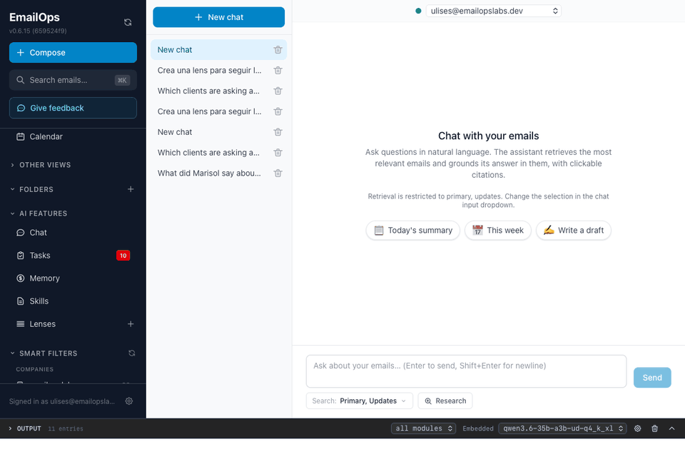

# EmailOps skills

Skills for [EmailOps](https://github.com/emailops/emailops), the local-first AI email
client: saved procedures that tell an AI how to handle one kind of email work, such as
triaging the inbox, chasing unanswered threads or drafting replies. Use them, adapt them,
and share your own.

A skill is a folder with a `SKILL.md`: a short header with a `name` and a `description` of
when to use it, then the instructions in Markdown. Skills are instructions only: the checks
in this repo refuse anything in a skill that could run on your machine.

There are two kinds, in two folders:

| Folder | Who uses the skill | How it reaches your mail |
|--------|--------------------|--------------------------|
| [`app-skills/`](app-skills) | The chat inside the EmailOps app | The chat's own tools, on your machine |
| [`agent-skills/`](agent-skills) | Hermes, Claude Code and other agents | `emailops-cli --json`, on your machine |

## Skills in this repo

Every recording below is a real run in the app on the EmailOps demo mailbox, whose people and messages
are all made up.

### App skills

[`inbox-triage`](app-skills/inbox-triage/SKILL.md) ranks what is waiting into act today,
this week and read later. Typing `/` in the chat lists your skills.



[`follow-up-check`](app-skills/follow-up-check/SKILL.md) finds the threads where you wrote
last and nobody answered.


### Agent skills

[`triage-inbox`](agent-skills/skills/triage-inbox/SKILL.md) runs the same triage from a
terminal: the agent reads your mail through `emailops-cli` and ranks it.

[`draft-replies`](agent-skills/skills/draft-replies/SKILL.md) reads an email and saves a
reply draft, which then shows up in EmailOps for you to review. It never sends.

## Install an app skill

Skills are an experimental feature of the app and are off by default.

1. In EmailOps, open **Settings → AI Skills** and turn on **Enable skills**.
2. Copy the skill's folder, for example `app-skills/inbox-triage`, into the `skills`
   folder of the app's data folder. The folder's name must stay the same as the skill's
   `name`. The data folder is:

   | System | Data folder |
   |--------|-------------|
   | macOS | `~/Library/Application Support/com.emailops.app` |
   | Windows | `%APPDATA%\com.emailops.app` |
   | Linux | `~/.local/share/com.emailops.app` |

3. Open the **Skills** view in the sidebar. The skill shows up there with its own switch.

The chat picks a skill when your question matches its description. You can also apply one
directly by starting a message with `/` and its name, for example `/inbox-triage`.

## Install the agent skills

You need the EmailOps app with at least one account, and `emailops-cli` on your `PATH`
(see the EmailOps CLI guide).

In Hermes, install the skills you want, one at a time:

```bash
hermes skills install emailops/emailops-skills/agent-skills/skills/triage-inbox
hermes skills install emailops/emailops-skills/agent-skills/skills/draft-replies
```

They show up as `/triage-inbox` and `/draft-replies`.

In Claude Code, every agent skill comes in one plugin, `emailops`:

```bash
claude plugin marketplace add emailops/emailops-skills
claude plugin install emailops@emailops-skills
```

They show up as `/emailops:triage-inbox` and `/emailops:draft-replies`.

In both, the agent also picks a skill when your request matches it. The skills read your
mail through the CLI on your machine; what the agent does with it depends on the agent and
the model you run. With a remote model, the mail it reads goes to that provider.

## Trust

A skill is a set of instructions an AI follows with access to your mail, so:

- A maintainer reads every skill in full before it is merged, and `make check` refuses
  scripts, shell snippets, hooks, hidden text and external links. No review can promise a
  skill is flawless, so read one before you install it. They are short.
- The EmailOps chat runs nothing from a skill and has no tool to send mail.
- An agent has a shell, and a skill cannot limit what it does with it. Keep your agent's
  permission prompts on.
- Nothing updates behind your back. An app skill is your own copy. Hermes updates with
  `hermes skills update`, and Claude Code with `claude plugin update emailops@emailops-skills`.
  In Claude Code that stays true unless you turn on auto-update for this marketplace.

## Contribute

New skills and improvements are welcome. Read [CONTRIBUTING.md](CONTRIBUTING.md), then
open a pull request. Every skill must pass `make check`, and examples may only use
made-up people and reserved domains such as `example.com`. To ask for a skill or report
one that misbehaves, open an issue. Report a harmful skill privately, as
[SECURITY.md](SECURITY.md) explains. Everyone here follows the
[code of conduct](CODE_OF_CONDUCT.md).

## License

[Apache-2.0](LICENSE), the same as EmailOps. By contributing you agree to license your
contribution under it.
